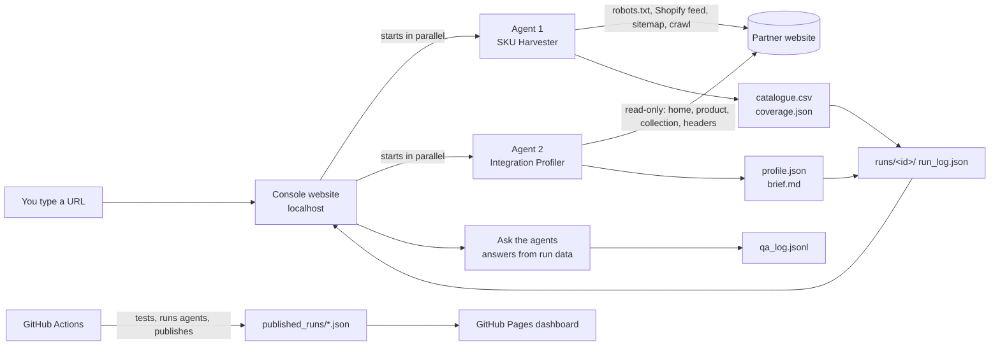

# Architecture

- **Agents** are ordinary command-line programs. The console runs them as separate processes, so the demo proves the real CLI works.
- **Each run** gets its own folder: the outputs, the full log, timings, and every question asked.
- **Fallback**: if a live run returns nothing, the console loads the agent's saved snapshot and labels it on screen.
- **GitHub mode**: Pages can only host static files, so GitHub Actions runs the agents (on push, daily, or on demand with a URL), saves the results to `published_runs/`, and redeploys the dashboard. The browser answers questions with a port of the same logic, tested for identical output.
- **Laptop mode**: the same dashboard served by `console.py` runs the agents directly, in seconds.
